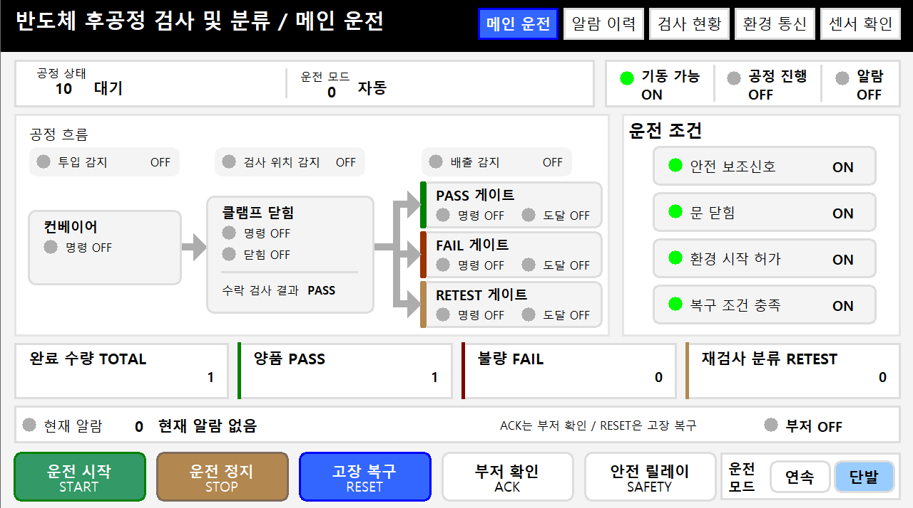
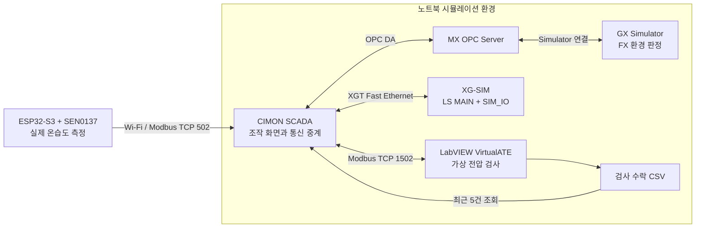
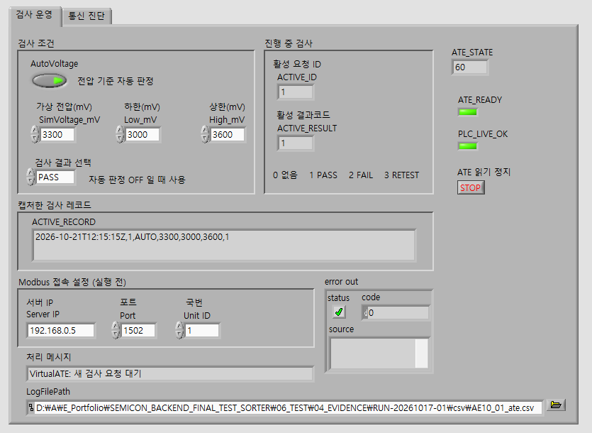
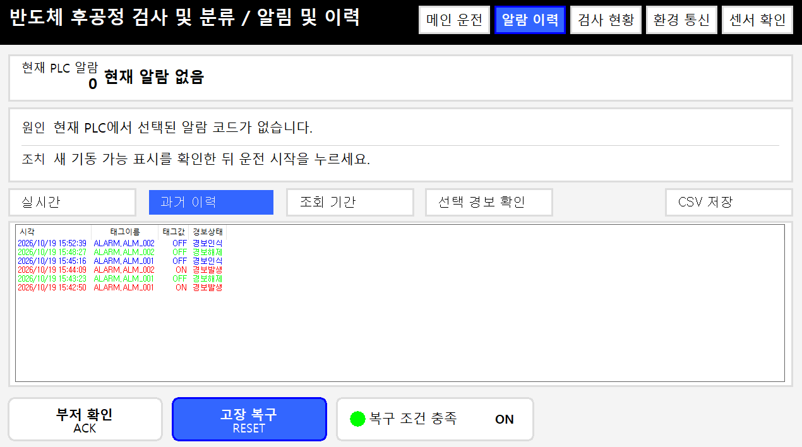
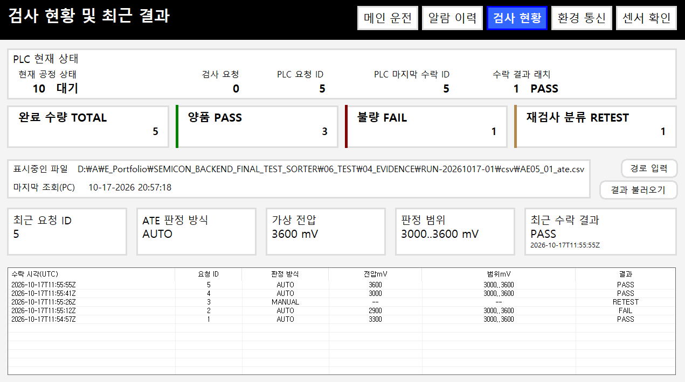
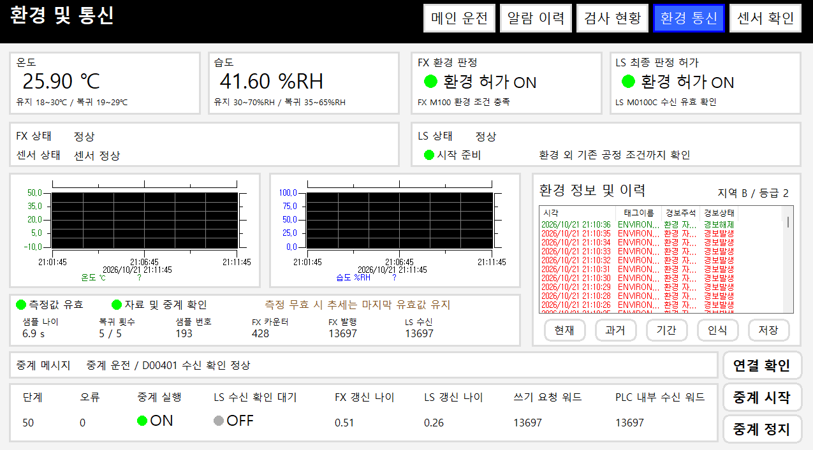
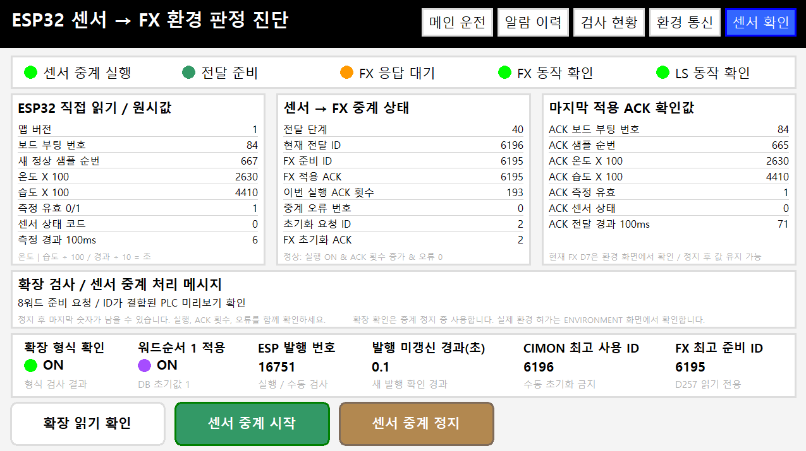

# 반도체 후공정 검사 및 분류 시스템

**SEMICON BACKEND FINAL TEST SORTER**

LS PLC의 공정 제어, 미쓰비시 FX의 환경 판정, CIMON SCADA, LabVIEW 가상 검사기와 ESP32 온습도 센서를 연동한 개인 프로젝트입니다. 제품 투입부터 검사 요청과 결과 수락, PASS / FAIL / RETEST 분류, 수량 집계, 이상 감시 및 수동 복구까지 구현했습니다.

기계 동작과 검사 전압은 시뮬레이션이고, **ESP32-S3와 SEN0137의 온습도 측정 및 Wi-Fi 통신은 실물**입니다.

- 작성 및 시험: **고진혁 Jinhyeok Ko**
- 검증: **필수 기능시험 25건 합격**, 실제 실행기록과 사진·영상·CSV 보관
- 문서: **최종 도면 22장 R0**, 시험 원장과 완료보고서

[완료보고서](06_TEST/06_FINAL_PDF/SIM_COMPLETION_REPORT_R0_ko.pdf) · [시험 원장 PDF](06_TEST/06_FINAL_PDF/SIM_TEST_RECORD_R0.pdf) · [도면 목차](02_PDF/README.md) · [동작 영상 압축본](06_TEST/04_EVIDENCE/RUN-20261017-01/video/encoded/)

P02 단발 PASS 시험 후의 메인 운전 화면입니다. 제품 1개 완료, PASS 1개, 대기 상태와 기동 조건을 함께 표시합니다.

## 시스템 구성

현재 LS와 FX의 데이터 교환은 CIMON 중계를 사용합니다. 두 실물 PLC 사이의 직접 통신은 이번 구현 범위에 포함하지 않았습니다.

| 구성 | 역할 | 개발 및 실행 환경 |
|---|---|---|
| LS PLC | 공정 시퀀스, 검사 요청·수락, 분류, 계수, 알람 | XG5000 4.78 / XG-SIM |
| SIM_IO | 제품 이동, 클램프·게이트 응답, 안전 입력 및 장치 고장 모사 | LS 프로젝트의 별도 프로그램 |
| 미쓰비시 FX | 센서 프레임 적용, 환경 허가 판정, 상태 워드 발행 | GX Works2 1.620W / GX Simulator |
| MX OPC Server | GX Simulator와 CIMON 연결 | MX OPC Server 6.10 |
| CIMON | 운전·알람·검사 이력·환경·센서 화면과 중계 스크립트 | CIMON 3.91.10 |
| VirtualATE | 가상 전압 또는 직접 선택한 결과로 판정, 수락 CSV 기록 | LabVIEW 2026 Q1 32Bit |
| 환경 센서 | DHT22 수집, 측정 상태·순번·경과시간, Modbus TCP 발행 | ESP32-S3-DevKitC-1 / SEN0137 / ESP-IDF 6.0.1 |

## 운영 화면

### LabVIEW 가상 검사기

가상 전압 3300 mV와 합격 범위 3000-3600 mV, 직전 요청 ID 1의 PASS 레코드가 표시된 새 검사 대기 화면입니다. 검사 조건, 활성 요청·결과, ATE 준비와 PLC 생존 상태, Modbus 접속 설정 및 CSV 경로를 한 화면에서 확인합니다.

### CIMON SCADA 5개 주요 페이지

**메인 운전은 README 상단에 표시했습니다.** 나머지 네 페이지는 아래에서 각각 펼쳐 볼 수 있습니다. 화면들은 서로 다른 시험 시점의 캡처입니다.

알람 이력 — 발생·해제·인식 기록과 수동 복구

P07 복구 후 현재 알람은 0이며, 과거 이력에는 알람 발생·해제·인식 기록이 남아 있습니다. 부저 확인 ACK와 고장 복구 RESET을 구분합니다.

검사 현황 — 최근 5건과 PASS / FAIL / RETEST 집계

AE05에서 확인한 PASS, FAIL, RETEST 및 하한·상한 PASS의 최근 5건과 수량 집계입니다. PLC 수락 CSV를 읽어 요청 ID, 판정 조건과 결과를 조회합니다.

환경 통신 — 실측 온습도와 FX·LS 허가 및 중계 상태

AE10 복구 후 온도 25.90 °C, 습도 41.60 %RH와 FX·LS 환경 허가 ON을 확인한 화면입니다. 자료 유효성, 시작 준비, 중계 오류와 FX 발행·LS 수신 워드를 함께 표시합니다.

센서 확인 — ESP32 원시값과 FX 준비·적용 ACK

실제 온습도 원시값과 FX에 전달하는 준비 ID, 적용 ACK, 발행번호 및 자료 경과시간을 구분해서 표시합니다. 거래 진행 중의 대기 단계도 화면에 표시합니다.

## 공정과 운전 정책

투입 감지 후 검사 위치로 이동하고 클램프를 닫습니다. LS가 요청 ID와 함께 검사를 요청하면 VirtualATE가 가상 검사 결과를 반환합니다. LS가 결과를 수락한 뒤 클램프를 열고 PASS, FAIL, RETEST 중 해당 게이트로 분류·배출한 다음 완료 수량을 집계합니다.

- **단발 운전**은 START 한 번에 제품 한 개를 처리합니다. **연속 운전**도 최초 START가 필요하며, 배출과 수거 조건을 확인한 뒤 다음 제품을 시작합니다.
- Auto / Manual과 단발 / 연속은 별도 선택입니다. Manual은 시퀀스 기동 금지와 조건부 수량 초기화를 위한 모드이며 개별 장치 Jog는 구현하지 않았습니다.
- 환경 시작 허가가 해제되면 진행 중 제품을 마무리하고 다음 기동을 차단합니다. STOP, 안전 입력 상실 및 장치 고장은 해당 정지·알람 정책으로 처리합니다.
- 원인 제거, 안전 복귀, 모델 정리와 공정 RESET을 구분합니다. 복구 후에는 새 START가 필요하며 자동으로 재출발하지 않습니다.
- RETEST는 별도 분류 결과입니다. 자동 재투입이나 반복 재검사는 구현하지 않았습니다.

## 통신과 기록에서 처리한 문제

| 문제 | 구현한 처리 |
|---|---|
| 서로 다른 시점에 갱신된 센서 워드가 섞일 수 있음 | 8개 값에 같은 발행번호를 포함하고, CIMON에서 일치 여부를 확인한 뒤 FX의 준비·미리보기·적용·ACK 순서로 전달 |
| 검사 결과와 요청 ID가 어긋나거나 DONE이 먼저 도착할 수 있음 | 결과·응답 ID 쓰기, PLC 수신 echo 확인, DONE 쓰기와 최종 수락 ID 확인을 분리 |
| 온습도 숫자가 남아 있어도 실제 데이터가 오래됐을 수 있음 | BOOT, 정상 샘플 순번, VALID, STATUS, AGE와 발행 카운터를 구분해 자료 신선도 확인 |
| 결과 수락 기록과 최종 생산 수량의 시점이 다름 | CSV는 PLC의 검사 결과 수락 시점, 생산 수량은 배출 완료 시점에 기록 |
| 복구 조작과 자동 재기동이 섞일 수 있음 | 안전 복귀·공정 RESET·새 START의 역할과 운전 기억을 분리 |

센서 통신은 FC04 원시 8워드와 발행번호를 포함한 확장 16워드, 총 24워드를 공개합니다. ATE 통신은 FC03 읽기, FC16 결과·응답 ID 쓰기, echo 확인 후 FC06 DONE 쓰기를 사용합니다. 상세 주소와 단위는 [도면 목차](02_PDF/README.md) 및 각 프로그램 README에 정리했습니다.

## 시험 결과

실제 기록 기간은 **KST 2026-10-17부터 2026-10-22까지**입니다. 각 시험은 실행 ID로 구분하며 전부 하나의 연속 세션으로 수행한 것은 아닙니다.

| 검증 항목 | 결과 및 근거 |
|---|---|
| 필수 기능시험 | P01-P17 및 AE01, AE02, AE05, AE08-AE12의 25건 합격 |
| 대표 5제품 검사 | TOTAL 5 / PASS 3 / FAIL 1 / RETEST 1, 요청 ID와 수락 ID 및 CSV 5행 대조 |
| 고장과 복구 | 위치·클램프·게이트·배출 고장, STOP·안전 모사, 환경 및 통신 상실 후 수동 복구 |
| AE11 연속 생산 기능 | 201 PASS, 완료 수량과 수락 CSV 201행 일치, CSV 중복 및 ID 불일치 0건 |
| AE12 정상 종료 | 중계 및 검사기 순차 정지 후 CimonX 정상 종료, 관측한 종료 약 8초 |
| 도면 대조 | 기능 기록 001-017의 17장과 개념 설계 018-022의 5장 |

**AE11의 합격 범위는 201건 생산·검사 수락·분류·CSV 정합 기능입니다.** 시험자 메모 기준 START부터 단발 전환까지는 29분 40초이며 중간 통신 관측과 수동 재START가 있었습니다. OPC 및 중계 통신 안정성, 30분 무중단 목표는 합의한 판정 범위에서 제외했습니다.

P17은 알람103, 공정 차단과 수동 복구 기능을 판정했습니다. 시험 중 대기 시간을 진행시켰으므로 설정 120초의 실제 경과시간을 측정한 결과로 보지 않습니다. 선택 시험 AE06과 FX01은 이번 완료 범위에 포함하지 않았습니다.

[시험 자료 안내](06_TEST/README.md)에서 원장, 증거와 계획·절차 이력의 관계를 확인할 수 있습니다. 시험 기준선 BL-001과 원본 영상은 로컬 보관하고, 저장소에는 기록 문서·캡처·CSV 및 별도의 영상 압축 사본을 제공합니다. 압축 사본은 원장에 적힌 원본 영상과 파일명·크기가 다를 수 있습니다.

## 저장소 구성

| 폴더 | 내용 |
|---|---|
| [01_CAD](01_CAD/README.md) | 최종 독립 DWG 22장, 기능 기록과 실물 개념 설계 |
| [02_PDF](02_PDF/README.md) | 최종 도면 PDF 22개와 한글 목차 |
| [03_EXPORT](03_EXPORT/README.md) | 도면에 사용하는 표 원본 XLSX 27개 |
| [04_REFERENCE](04_REFERENCE/README.md) | 외부 참고자료의 용도 안내 |
| [05_IMAGE](05_IMAGE/README.md) | README에 사용하는 자체 시험 캡처 |
| [06_TEST](06_TEST/README.md) | 시험 계획·절차, 실제 원장, 증거, 완료보고서 |
| [SEMICON_SORTER](SEMICON_SORTER/README.md) | LS 주공정과 SIM_IO 프로젝트 |
| [SEMICON_SORTER_ENV](SEMICON_SORTER_ENV/README.md) | FX 환경 판정과 MX OPC 설정 |
| [SEMICON_SORTER_HMI](SEMICON_SORTER_HMI/README.md) | CIMON 화면·태그·통신 설정·스크립트 |
| [SEMICON_SORTER_ATE](SEMICON_SORTER_ATE/README.md) | LabVIEW 가상 검사기와 CSV 기록 VI |
| [SEMICON_SORTER_SENSOR](SEMICON_SORTER_SENSOR/README.md) | ESP-IDF 센서·Wi-Fi·Modbus TCP 소스 |

## 실행 안내

이 프로젝트는 각 PLC·SCADA·LabVIEW 개발 도구가 설치된 Windows 환경에서 실행합니다. 소프트웨어 배포 파일은 저장소에 포함하지 않습니다.

1. [완료보고서](06_TEST/06_FINAL_PDF/SIM_COMPLETION_REPORT_R0_ko.pdf)와 [시험 원장](06_TEST/03_RECORD/SIM_TEST_RECORD_R0.xlsx)의 기준설정으로 버전, 주소, 주기와 실행 범위를 확인합니다.
2. LS 프로젝트를 열고 프로그램 순서를 SIM_IO 다음 MAIN으로 확인합니다. GX Simulator와 MX OPC 설정을 준비합니다.
3. ESP32는 로컬 menuconfig에서 Wi-Fi 접속 정보를 지정하고 빌드·다운로드합니다. 실행 로그의 실제 IP를 CIMON에 반영합니다.
4. CIMON에서 환경 중계를 시작하고 FX·LS 자료 정상을 확인한 다음 센서 중계를 시작합니다. 센서 전달 ACK 및 환경 판정을 확인합니다.
5. LabVIEW의 VirtualATE_V3.vi를 열어 통신 설정과 CSV 저장 경로를 지정한 뒤 실행합니다. 원시 정상 조건, 안전 복귀와 공정 RESET으로 대기 상태를 준비한 뒤 START합니다.

버튼 및 주소별 상세 조작은 해당 폴더 README와 시험 문서를 따릅니다. 재현 환경에 맞는 통신 대상과 저장 경로를 설정해야 하며 로컬 절대 경로와 과거 IP를 그대로 복사하지 않습니다.

## 현재 범위와 확장 설계

- 실제 검증한 하드웨어는 ESP32-S3와 SEN0137 센서 시제품입니다. 기록된 배선은 VCC 3V3, 공통 GND, 신호 GPIO4입니다.
- 실물 PLC, 컨베이어, 제어반, 모터 및 공압 장치의 결선·처리량·정지거리와 안전 성능은 시험하지 않았습니다.
- 도면 018-022는 **CONCEPT / NOT FOR CONSTRUCTION** 상태의 확장 설계입니다. 하드웨어 안전 릴레이와 물리 I/O를 구현 완료한 것으로 해석하지 않습니다.
- 검사 전압은 가상값이며 실제 반도체 DUT 또는 계측 장비를 연결하지 않았습니다.
- 통신 단절의 확정 원인 규명, 장기 무중단 운전, 전원 상실을 포함한 영구적인 CSV 중복 방지는 검증 범위에 포함하지 않았습니다.

공개 파일과 로컬 보관 파일의 구분 및 업로드 전 확인 사항은 [GitHub 업로드 안내](GITHUB_UPLOAD_ko.md)에 정리했습니다. 외부 도구와 라이브러리는 각 제공자의 배포 조건을 따르며, 이 저장소에 임의의 라이선스 선언을 추가하지 않았습니다.
